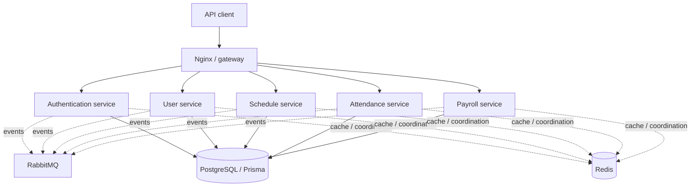

# Smart Workforce — Distributed Workforce Management

**A Node.js and TypeScript microservices project for workforce management, scheduling, attendance, and payroll.**

Smart Workforce explores the backend architecture of a distributed workforce platform. The code is under [`smart-workforce/`](./smart-workforce/) and includes npm workspaces, containerized local infrastructure, an API gateway, and integration tests.

## System overview



*Conceptual architecture. Refer to the Compose files for the exact runtime wiring and data isolation boundaries.*

## Engineering highlights

- **Service-oriented APIs:** distinct authentication, users, scheduling, attendance and payroll services.
- **Event-driven workflows:** RabbitMQ integration for asynchronous communication.
- **Persistence and coordination:** PostgreSQL/Prisma and Redis.
- **Local deployment:** Docker Compose with gateway-only public ingress.
- **Testability:** shared packages and Jest integration tests across service workflows.

## Repository map

| Area | Location |
| --- | --- |
| Authentication | [`smart-workforce/services/auth-service`](./smart-workforce/services/auth-service) |
| User management | [`smart-workforce/services/user-service`](./smart-workforce/services/user-service) |
| Scheduling | [`smart-workforce/services/schedule-service`](./smart-workforce/services/schedule-service) |
| Attendance | [`smart-workforce/services/attendance-service`](./smart-workforce/services/attendance-service) |
| Payroll | [`smart-workforce/services/payroll-service`](./smart-workforce/services/payroll-service) |
| Shared packages | [`smart-workforce/packages`](./smart-workforce/packages) |
| Integration tests | [`smart-workforce/tests`](./smart-workforce/tests) |
| Local Docker guide | [`smart-workforce/README.docker.md`](./smart-workforce/README.docker.md) |

## Run locally

Requires Docker Desktop/Engine and resources to run the containers. Follow the [Docker guide](./smart-workforce/README.docker.md) to configure the required `GATEWAY_TOKEN`; never use development credentials in production.

```bash
cd smart-workforce
docker compose -f docker-compose.local.yml up --build
```

The gateway is configured at `http://localhost:8080` in local mode, while internal service ports remain private.

For local development and integration checks:

```bash
cd smart-workforce
npm ci
npm run build
npm run test:integration
```

This repository is an **engineering portfolio demonstration**, not a public production payroll service. No hosted demo is currently claimed.

---

Developed by [Ahmed Abdelrahman](https://github.com/Ahmed2902). Also see [Systemly](https://github.com/Ahmed2902/SystemlyBackEnd) and [Metrico](https://metrico.live).
